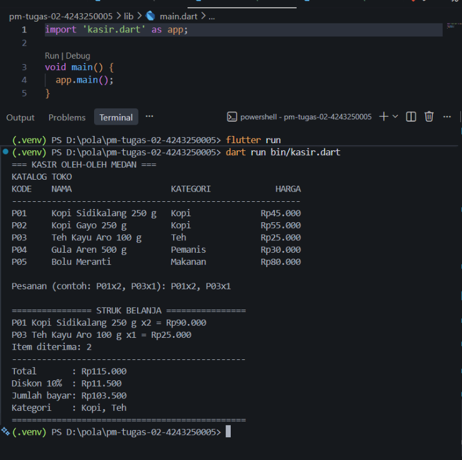
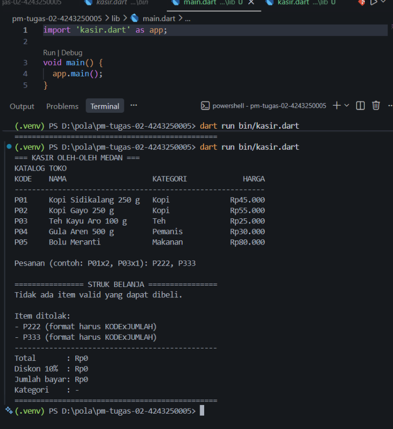
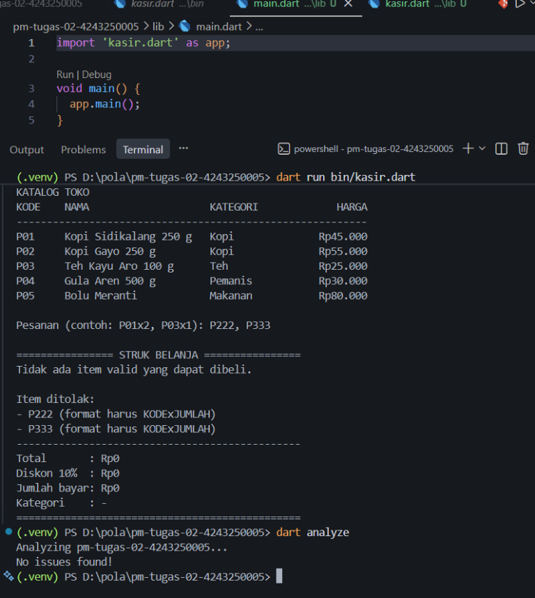

# Tugas Rutin 2 — Aplikasi Console Kasir Sederhana

**Nama:** Christian Nicholas Sinaga  
**NIM:** 4243250005  
**Kelas:** PSIK 24C

## Deskripsi

Program kasir console untuk toko oleh-oleh Medan. Program menampilkan lima
produk, menerima pesanan satu baris, mencetak subtotal dan struk, memberi diskon
10% untuk total minimal Rp100.000, serta mencatat kategori produk yang dibeli.
Kode atau jumlah pesanan yang tidak valid dicatat sebagai item ditolak, bukan
membuat program crash.

## Menjalankan dan memeriksa

Pastikan Dart SDK terpasang, lalu jalankan dari folder proyek:

```powershell
dart pub get
dart run bin/kasir.dart
dart analyze
dart test
```

Masukkan daftar pesanan satu baris, dipisahkan koma. Contoh:

```text
P01x2, P03x1
```

## Penjelasan variabel dan null safety (100–200 kata)

Di [baris 24–25](bin/kasir.dart#L24), `const` dipakai untuk batas diskon dan
katalog yang nilainya tetap. `final` dipakai untuk hasil pembacaan input di
[baris 43](bin/kasir.dart#L43), hasil parsing, dan baris struk yang hanya
ditetapkan sekali. `var acceptedItemCount = 0` di
[baris 143](bin/kasir.dart#L143) menjadi penghitung item: Dart menyimpulkan
tipenya sebagai `int`, lalu nilainya bertambah selama perulangan. Total belanja
dijumlahkan dengan `fold` di [baris 120–122](bin/kasir.dart#L122), yang menerima
nilai akumulasi dan subtotal berikutnya. Ketiganya membantu menjelaskan niat
kode tanpa memakai `dynamic`.

Null safety mencegah akses ke nilai yang mungkin tidak ada. `readLineSync()`
menghasilkan `String?`, sehingga program memeriksa `null` di
[baris 43–45](bin/kasir.dart#L43) sebelum memproses input. `int.tryParse()`
juga menghasilkan `int?`; jumlah diperiksa di [baris 97–101](bin/kasir.dart#L97)
dan harus lebih besar dari nol sebelum digunakan. Pencarian `catalog[code]`
menghasilkan `Product?` di [baris 91–95](bin/kasir.dart#L91), jadi kode produk
yang tidak ditemukan dicatat sebagai item ditolak sebelum properti produk
diakses. Pemeriksaan tersebut membuat input kosong, kode tak dikenal, dan jumlah
tidak valid tidak menyebabkan program crash. Operator `!` tidak digunakan.

## Bukti tangkapan layar

### Pesanan valid

Input `P01x2, P03x1` menghasilkan total Rp115.000, diskon Rp11.500, dan jumlah
bayar Rp103.500.



### Pesanan dengan format tidak valid

Input `P222, P333` ditolak karena tidak mengikuti format `KODExJUMLAH`.
Program tetap mencetak struk dan memberi keterangan kesalahan tanpa crash.



### Validasi kode

Perintah `dart analyze` selesai dengan hasil `No issues found!`.



## Penggunaan AI

AI digunakan sebagai bantuan untuk menyusun draf implementasi, kasus uji, dan
penjelasan README. Kode kemudian diperiksa dengan `dart analyze` dan `dart test`.


